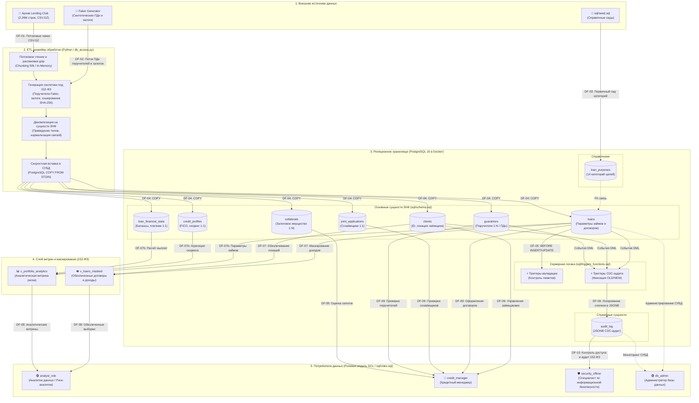

# 🔄 Диаграмма потоков данных (Data Flow Diagram, DFD)

Данный документ описывает жизненный цикл и архитектуру движения данных в системе: от исходных внешних источников (архив кредитного скоринга Lending Club и модуль генерации синтетических персональных данных по 152-ФЗ) через потоковый ETL-конвейер на Python до нормализованного хранилища PostgreSQL 16 в Docker, триггеров бизнес-валидации, CDC-аудита и витрин разграничения доступа.

---

## 1. Реестр интерфейсов и потоков данных

| ID потока | Источник (Source) | Приёмник (Target) | Передаваемые данные | Формат / Протокол | Назначение потока |
| :---: | :--- | :--- | :--- | :--- | :--- |
| **DF-01** | Внешний архив (Kaggle) | Python ETL (`db_access.py`) | 2.26 млн сырых записей кредитных историй, скоринга и платежей | CSV.GZ (Gzip-сжатый CSV, UTF-8, RFC 4180) | Извлечение (Extract) исторических данных Lending Club с потоковой декомпрессией чанками |
| **DF-02** | Модуль генерации ПДн (`Faker`) | Python ETL (`db_access.py`) | Синтетические ФИО поручителей, телефоны, вычисленные хеши паспортов (SHA-256), данные залогов | Python In-Memory Generator Stream | Обогащение обезличенного набора реалистичными ПДн для соблюдения требований 152-ФЗ |
| **DF-03** | Сид-скрипт (`sql/seed.sql`) | PostgreSQL (`loan_purposes`) | 14 нормализованных категорий целей кредитования | SQL DML (`INSERT ... ON CONFLICT`) | Первичное наполнение системных классификаторов до старта пакетного импорта |
| **DF-04** | Python ETL (`db_access.py`) | PostgreSQL (7 таблиц 3НФ) | Очищенные, приведенные к типам и валидированные батчи записей | `psycopg` Binary Stream / `COPY FROM STDIN` | Скоростная пакетная загрузка 2.26M строк с поддержанием ссылочной целостности FK |
| **DF-05** | Таблица `loans` | Серверная логика (`triggers_functions.sql`) | Новые и модифицируемые строки заявок и кредитных договоров | PL/pgSQL (`BEFORE INSERT OR UPDATE`) | Контроль бизнес-правил (неотрицательность балансов, лимиты сумм, допустимые грейды) |
| **DF-06** | Серверные триггеры CDC | Таблица `audit_log` | Имя таблицы, тип операции, timestamp, пользователь, снимки OLD/NEW | JSONB (`AFTER INSERT OR UPDATE OR DELETE`) | Неизменяемый структурированный аудит операций над чувствительными данными (152-ФЗ) |
| **DF-07** | Таблицы `loans`, `clients` | Маскированные представления (`VIEW`) | Обезличенные анкеты заёмщиков со скрытыми персональными данными и доходами | SQL Security Views (DCL) | Динамическая изоляция конфиденциальных сведений по 152-ФЗ |
| **DF-07b** | Таблицы `loans`, `loan_financial_state`, `credit_profiles` | Материализованная витрина (`MATERIALIZED VIEW`) | Предрассчитанные тяжелые агрегаты портфеля, скоринговые метрики и статистика дефолтов | SQL Materialized View | Высокопроизводительная витрина для бизнес-аналитиков без пересчёта 2.26M строк |
| **DF-08** | Маскированные представления | Роль `analyst_role` | Деперсонализированные выборки, метрики дефолтов, витрины | SQL Query / Read-Only Cursor | Анализ кредитного портфеля, скоринговое моделирование, построение отчётов |
| **DF-09** | Таблицы `clients`, `loans`, `joint_applications`, `guarantors`, `collaterals` | Роль `credit_manager` | Анкеты заёмщиков, параметры заявок, договоры, обеспечение и поручители | SQL Client / Транзакционный доступ (OLTP) | Ведение клиентских профилей, скоринг, оформление договоров и проверка обеспечения |
| **DF-10** | Таблица `audit_log` | Роль `security_officer` | Хронологический журнал событий, факты модификации записей и доступа к ПДн | SQL SELECT (Read-Only) | Контроль соблюдения 152-ФЗ, аудит прав доступа, расследование инцидентов ИБ |

---

## 2. Архитектурная контекстная DFD-диаграмма

Диаграмма визуализирует границы системы, внешние сущности, вычислительные процессы, физические хранилища и потоки разграничения прав.


---

## 3. Спецификация технических форматов и протоколов

### 3.1. Первичный входной поток (Lending Club CSV.GZ)
* **Формат хранения:** Сжатый архив GZIP (`.csv.gz`), кодировка текста UTF-8, экранирование RFC 4180.
* **Объём данных:** 2 260 701 строка, 151 исходный столбец.
* **Особенности предобработки:** Потоковая декомпрессия (in-memory streaming через модуль `gzip` / параметр `chunksize=50000` библиотеки `pandas`) без предварительной физической распаковки файла на диск, что исключает переполнение дискового пространства хоста.

### 3.2. Синтетический поток ПДн и обеспечения (152-ФЗ)
* **Сущность `clients` (клиенты):** Суррогатный первичный ключ `client_id` генерируется последовательно в конвейере ETL ввиду отсутствия `member_id` в исходном архиве. Поле `zip_code` сохраняется строковым типом `CHAR(5)` с сохранением маскирования исходного датасета (вида `954xx`).
* **Сущность `guarantors` (поручители):** Так как датасет Lending Club обезличен, для ~10% договоров генерируются синтетические поручители библиотекой `Faker(locale='ru_RU')` (ФИО, телефон, доход, отношение к заёмщику).
* **Паспортные данные поручителей:** Не сохраняются в открытом виде. Вычисляется криптографический хеш алгоритмом SHA-256:
  $$\text{passport\_hash} = \text{SHA256}(\text{series} + \text{number} + \text{salt})$$
  Формат в базе данных: `CHAR(64)` с контролем составного ограничения уникальности `UNIQUE (loan_id, passport_hash)`.
* **Сущность `collaterals` (залоги):** Синтезируются типы обеспечения (недвижимость, автотранспорт), оценочная стоимость, кадастровые номера и VIN-коды (`CHAR(17)`) для отработки аналитических запросов по кредитному покрытию.

### 3.3. Внутренний протокол загрузки в PostgreSQL
* **Драйвер подключения:** Python `psycopg3`.
* **Механизм переноса:** Использование протокола потокового копирования `COPY ... FROM STDIN (FORMAT CSV, DELIMITER ',', QUOTE '"', ESCAPE '"')` для обеспечения скорости загрузки свыше 25 000 строк/сек при сохранении ссылочной целостности внешних ключей.

### 3.4. Служебный формат лога аудита (JSONB)
* Таблица `audit_log` хранит метаданные операции в реляционных столбцах (`audit_id`, `table_name`, `record_id`, `operation`, `changed_by`, `changed_at`), а слепки состояния строки фиксируются в столбцах типа `JSONB`:
  * **`old_value`** (снимок до операции):
    ```json
    {
      "loan_status": "Current",
      "out_prncp": 12500.00,
      "last_pymnt_d": "2018-09-01"
    }
    ```
  * **`new_value`** (снимок после операции):
    ```json
    {
      "loan_status": "Fully Paid",
      "out_prncp": 0.00,
      "last_pymnt_d": "2018-10-01"
    }
    ```